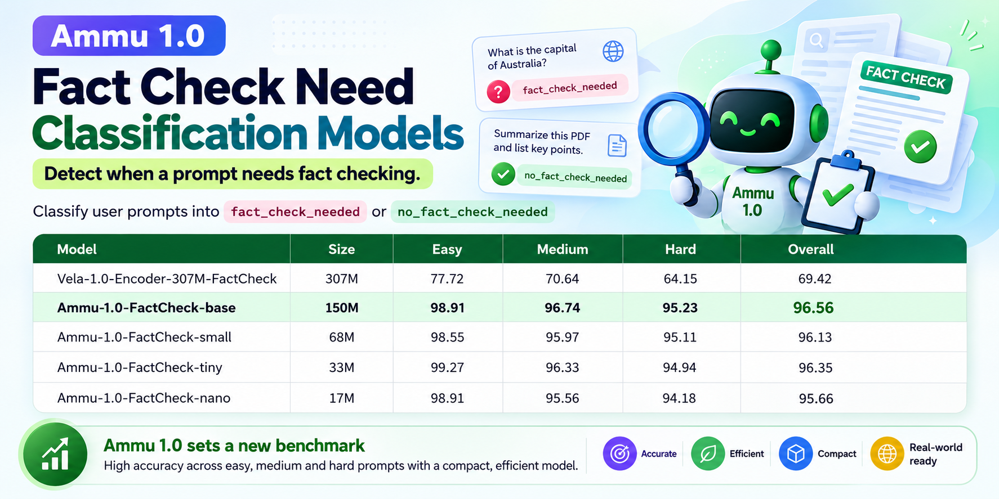

# 🛡️ Ammu-1.0-FactCheck: Lightweight FactCheck Need Classification Models

<p align="center">
  <a href="https://huggingface.co/collections/kalyan-ks/ammu-10-factcheck-needed"></a>
  <a href="https://huggingface.co/datasets/kalyan-ks/fact-check-need-classification"></a>
  <a href="https://huggingface.co/spaces"></a>
  <a href="https://opensource.org/licenses/MIT"></a>
  <a href="https://www.python.org/downloads/"></a>
</p>

**Ammu-1.0-FactCheck** is a family of lightweight fact check need classification models which can detect whether incoming user queries require factual grounding (**`FACT_CHECK_NEEDED`**) or can be processed directly without external retrieval (**`NO_FACT_CHECK_NEEDED`**).

<p align="center">
  
</p>

Built on the modern **ModernBERT** encoder architecture, the model family scales from **17M down to 150M parameters** (`base` 150M, `small` 68M, `tiny` 33M, and `nano` 17M) and outperforming Vela 1.0 Fact Check model (307M) model by  more than **25 Macro F1 points**. 

These models can be used an upfront guardrail that directs queries to retrieval-augmented generation (RAG) pipelines or web search engines only when factual grounding is genuinely needed.

---

## ⚡ The Problem: Latency & Cost in LLM based Systems

In production LLM and Retrieval-Augmented Generation (RAG) pipelines, blindly querying external search engines, vector databases, or web crawlers for every user prompt introduces severe penalties:

- **2,000–5,000 ms latency overhead** per request.
- **Unnecessary Search API costs** for self-contained tasks (creative writing, coding, math derivations, brainstorming, and input-text NLP transformations).

```
                            User Prompt
                                │
                                ▼
               ┌─────────────────────────────────┐
               │  Ammu-1.0 FactCheck Need Model  │  ◄── [Sub-millisecond decision]
               └────────────────┬────────────────┘
                                │
        ┌───────────────────────┴───────────────────────┐
        ▼                                               ▼
[FACT_CHECK_NEEDED]                           [NO_FACT_CHECK_NEEDED]
  │ (Search / RAG / Knowledge Base)             │ (Direct LLM Response)
  ▼                                             ▼
External Knowledge Retrieval                   Skip Retrieval (~2–5s saved!)
```

---

## 📊 Benchmark Leaderboard

Evaluated on a test set of of **4,214 balanced instances** across three difficulty tiers (*Easy*, *Medium*, *Hard*):

| Model | Architecture | Params | Easy F1 (%) | Medium F1 (%) | Hard F1 (%) | Overall Macro-F1 (%) |
|:---|:---|:---:|:---:|:---:|:---:|:---:|
| `Vela-1.0-Encoder-FactCheck` | ModernBERT | 307M | 77.72 | 70.64 | 64.15 | **69.42** |
| **Ammu-1.0-FactCheck-Need-base** | ModernBERT | 150M | 98.91 | 96.74 | 95.23 | **96.56** |
| **Ammu-1.0-FactCheck-Need-small** | ModernBERT | 68M | 98.55 | 95.97 | 95.11 | 96.13 |
| **Ammu-1.0-FactCheck-Need-tiny**<sup>*</sup>   | ModernBERT | 33M | 99.27 | 96.33 | 94.94 | 96.35 |
| **Ammu-1.0-FactCheck-Need-nano**<sup>*</sup> | ModernBERT | 17M | 98.91 | 95.56 | 94.18 | 95.66 |

**Note** - * - Tiny and Nano models are trained using knowledge distillation with Ammu-1.0-FactCheck-Need-base as the teacher model. 

### Key Highlights
 Achieves a 96.56% overall Macro-F1 score  outperforming the 307M parameter baseline by more than +27% Macro-F1 points.
- Ammu-1.0-FactCheck-Need models are built upon ModernBERT architecture with 150M (base), 68M (small), 32M (tiny) and 17M (nano) sizes.
-  Trained on balanced synthetic data spanning 120 granular topics, 19 prompt interaction formats, and 29 user personas.
-  Tiny and Nano models are trained using knowledge distillation with Ammu-1.0-FactCheck-Need-base as the teacher model. 
-  Models run on CPU with high throughput and low latency.
-  MIT licensed and ready for real world use.

---

## 🚀 Quickstart

### 1. Installation

```bash
pip install transformers torch
```

### 2. Basic Inference (Hugging Face `pipeline`)

```python
from transformers import pipeline

# Choose from: 'base', 'small', 'tiny', 'nano'
classifier = pipeline("text-classification", model="kalyan-ks/Ammu-1.0-FactCheck-Need-nano")

# Example 1: NLP Transformation on user-supplied text
res1 = classifier("Extract all country names mentioned in this paragraph: 'Paris is the capital of France.'")
print(res1)
# Output: [{'label': 'NO_FACT_CHECK_NEEDED', 'score': 1.0}]

# Example 2: Query requiring live world knowledge
res2 = classifier("What was the repo rate announced by RBI in the latest monetary policy meeting?")
print(res2)
# Output: [{'label': 'FACT_CHECK_NEEDED', 'score': 1.0}]
```

### 3. Production RAG Router Integration

```python
import torch
from transformers import pipeline

class FactCheckNeedRouter:
    def __init__(self, model_name="kalyan-ks/Ammu-1.0-FactCheck-Need-nano", threshold=0.75):
        device = 0 if torch.cuda.is_available() else -1
        self.pipe = pipeline("text-classification", model=model_name, device=device)
        self.threshold = threshold

    def should_retrieve(self, user_query: str) -> bool:
        prediction = self.pipe(user_query)[0]
        label = prediction['label']
        confidence = prediction['score']
        
        # Route to retrieval only if factual check is needed with high confidence
        return label == "FACT_CHECK_NEEDED" and confidence >= self.threshold

# Initialize router
router = FactCheckNeedRouter()

query = "Write a python function to compute fibonacci numbers"
if router.should_retrieve(query):
    print("Calling Web Search / Vector DB...")
else:
    print("Direct LLM Generation (Bypassing Retrieval)...")
```
---

## 🧠 Methodology & Dataset Architecture

The models are trained and benchmarked on the **[kalyan-ks/fact-check-need-classification](https://huggingface.co/datasets/kalyan-ks/fact-check-need-classification)** dataset.

### 1. 8-Dimensional Seed Taxonomy (241 Leaf Nodes)
The dataset samples across 8 distinct dimensions:
- *3 Domain Groups**: `FACT_CHECK_NEEDED` (50%), `NO_FACT_CHECK_INPUT_TEXT` (25%), `NO_FACT_CHECK_GENERATIVE` (25%).
- **Topics & Subtopics**: 17 parent domains across 120 subtopics (finance, medicine, history, law, coding, creative, math, etc.).
- **User Personas**: 29 personas across 4 expertise tiers (Novice, Intermediate, Knowledgeable, Expert).
- **Linguistic Registers & Tones**: 8 registers (casual, technical, academic, slang) and 9 emotional tones.
- **Difficulty Nuances**: Calibrated into **20% Easy**, **40% Medium**, and **40% Hard**.

### 2. Hard Boundary Engineering & Orthogonal Distractors
The benchmark explicitly tests and overcomes shallow lexical shortcuts:
- **Factual Distractors in NLP Tasks (`NO_FACT_CHECK_NEEDED`)**: Sentences loaded with real-world entities and dates where the task is purely grammatical or structural (e.g., entity extraction, translation, summarization).
- **Math Word Problems Requiring External Facts (`FACT_CHECK_NEEDED`)**: Arithmetic problems dependent on unstated historical or real-world numbers (e.g., calculating age relative to a celebrity's unstated birth year).
- **Coding with Live API Specs (`FACT_CHECK_NEEDED`)**: Code requests strictly bound to evolving external API deprecations or cloud schemas.

### 3. Quality Filtering & GPU Deduplication
- **Two-Stage Quality Gates**: 4 deterministic programmatic validators followed by an LLM Judge scoring rubric ($Q \ge 3.0 / 4.0$).
- **Intra-Label GPU Semantic Deduplication**: Powered by **NVIDIA NeMo Curator SemDeDup** ($\ge 0.92$ cosine similarity threshold using `google/embeddinggemma-300m`). Intra-label deduplication guarantees contrastive decision boundary preservation.
- **Stratified Partitioning**: 28,088 total gold instances split into **Train (75%)**, **Validation (10%)**, and **Test (15%)** maintaining balanced difficulty ratios.

---

## 💻 Interactive Gradio Demo

An interactive Gradio application is included in [`app.py`](./app.py) featuring:
- Real-time classification with confidence breakdown.
- Model switching between all 4 parameter scales (`base`, `small`, `tiny`, `nano`).
- ZeroGPU compatibility for Hugging Face Spaces.

To run locally:
```bash
git clone https://github.com/KalyanKS-NLP/ammu-fact-check-need-classifier-models.git
cd ammu-fact-check-need-classifier-models
pip install -r assets/requirements.txt
python assets/app.py
```

---

## 🔬 Reproducing the Benchmark

You can reproduce the evaluation benchmarks against the holdout test set using the standalone notebook:
- [`FactCheck - Model Eval and Comparison.ipynb`](./assets/FactCheck%20-%20Model%20Eval%20and%20Comparison.ipynb)

This downloads the public test set from Hugging Face Datasets and runs deterministic evaluation against all model variants.

---

## 📦 Model Collection Summary

| Model | Hugging Face Hub ID | Parameters | Recommended Use Case |
|---|---|:---:|---|
| **Base** | [`kalyan-ks/Ammu-1.0-FactCheck-Need-base`](https://huggingface.co/kalyan-ks/Ammu-1.0-FactCheck-Need-base) | 150M | Flagship accuracy, server-side batch routing |
| **Small** | [`kalyan-ks/Ammu-1.0-FactCheck-Need-small`](https://huggingface.co/kalyan-ks/Ammu-1.0-FactCheck-Need-small) | 68M | High throughput cloud microservices |
| **Tiny** | [`kalyan-ks/Ammu-1.0-FactCheck-Need-tiny`](https://huggingface.co/kalyan-ks/Ammu-1.0-FactCheck-Need-tiny) | 33M | CPU inference & low-cost serverless containers |
| **Nano** | [`kalyan-ks/Ammu-1.0-FactCheck-Need-nano`](https://huggingface.co/kalyan-ks/Ammu-1.0-FactCheck-Need-nano) | 17M | Ultra-low latency edge devices & browser extensions |

---

## 📜 Citation & License

This project is licensed under the [MIT License](LICENSE).

```bibtex
@misc{ammu2026factcheckneed,
  author = {Kalyan KS},
  title = {Ammu-1.0-FactCheck-Need: Ultra-Lightweight Fact Check Need Classifier Models},
  year = {2026},
  publisher = {Hugging Face},
  howpublished = {\url{https://huggingface.co/collections/kalyan-ks/ammu-10-factcheck-needed}}
}
```


